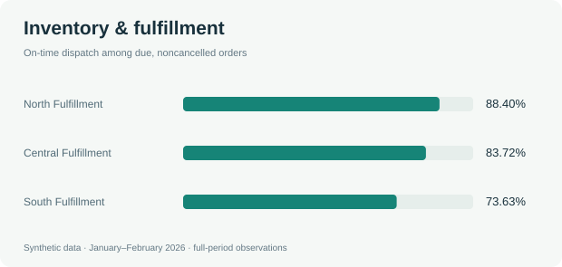
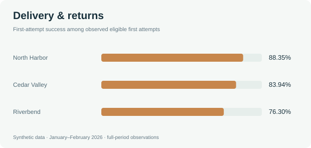

# Supply Chain Analytics Portfolio

**Venkateswarlu Bathina · Inventory, fulfillment, delivery, and returns analytics**

Two reproducible case studies turn synthetic operational records into SQL measures, exception lists, and interactive browser dashboards. The portfolio emphasizes clear KPI definitions, data validation, and decisions an operations team could investigate.

## What is included

| Case study | Dataset scope | Operational questions |
| --- | --- | --- |
| [Inventory and Fulfillment](projects/inventory_fulfillment/README.md) | 8,391 accepted order records, 240 SKUs, 3 warehouses, and 1,344 cycle-count audits | Which audited stock records disagree? Which orders are overdue for dispatch? Which stock positions need replenishment review? |
| [Delivery and Returns](projects/delivery_returns/README.md) | 5,457 shipments, 6,032 clean attempt events, 3 hubs, and 557 return cases | Where are first attempts failing? Which due shipments remain undelivered? Which open returns need attention? |

The examples cover January 1 through February 25, 2026. Each project records its exact reporting cutoff and KPI eligibility rules. Counts above come from the included deterministic datasets; changing a generator or filter can change the results.

## Status and ownership

This is an assistant-generated starter portfolio prepared for Venkateswarlu. Before including it as personally completed work, reproduce the results, review the SQL, and make a meaningful documented improvement; use the [review checklist](docs/PORTFOLIO_REVIEW_CHECKLIST.md). All data is synthetic and has no connection to employer systems or performance. The included dashboards run in a browser. Power BI modeling guidance and DAX source are included as extensions; no `.pbix` or Tableau workbook has been built.

## Run the portfolio

For an immediate preview, open `docs/index.html` in a browser. The bundled assets and datasets work offline. Use the commands below to regenerate the analysis or serve the site locally.

Use Python 3.11 or later. The analytics pipeline uses the Python standard library and SQLite; no package installation or cloud account is required.

```bash
python build_all.py
python -m http.server 8000 --directory docs
```

Open `http://localhost:8000` in a browser. The first command rebuilds the synthetic data, analytics outputs, and static website. The second serves the generated website locally; stop it with `Ctrl+C`.

The project READMEs contain individual build commands, validation commands, raw data grains, and model definitions. The [GitHub setup guide](docs/GITHUB_SETUP.md) explains how to upload the extracted repository and publish the static site from `/docs`.

## What the analysis demonstrates

### Inventory and fulfillment

- Reconcile cycle counts at the audited SKU/location grain using an explicit count tolerance.
- Measure dispatch timeliness against promised dispatch dates, including due-but-open orders in the eligible cohort.
- Separate total open backlog from overdue backlog.
- Review replenishment exceptions, stockout positions, excess coverage, and ABC segmentation.
- Quarantine deliberately injected duplicate, invalid, and inconsistent records before calculation.

The default synthetic run identifies **153 replenishment exceptions** and **291 overdue order records**. These are review queues generated by the documented rules, not realized savings or evidence of an operational improvement.

### Delivery and returns

- Calculate first-attempt success and due-cohort delivery timeliness using their respective denominators.
- Keep failed-delivery return-to-origin separate from post-delivery customer returns.
- Show completed return duration alongside open-return aging.
- Calculate attributable shipment cost with cost coverage visible.
- Handle duplicate scans and conflicting event IDs explicitly.

The default synthetic run contains **78 open returns**, including **18 older than seven days**, and **257 matured shipments that remain undelivered**. These findings demonstrate exception prioritization, without asserting that a proposed action changed an outcome.

## Repository guide

| Path | Contents |
| --- | --- |
| `build_all.py` | Rebuild both datasets and the portfolio website |
| `projects/inventory_fulfillment/` | Inventory generator, SQLite queries, CSV outputs, validation, and Power BI extension |
| `projects/delivery_returns/` | Delivery/returns generator, SQLite queries, CSV outputs, validation, and Power BI extension |
| `docs/` | Static website and setup/review/resume guidance |
| `site_source/` | Editable HTML, CSS, and JavaScript for the dashboard interface |
| `.github/workflows/validate.yml` | Rebuild and analytical validation on pushes and pull requests |
| `LICENSE` | MIT license for the project source and synthetic fixtures |

## Preview

The interactive site includes location filters, weekly metric selection, searchable exception tables, CSV export, and visible KPI definitions. These static charts summarize the default synthetic run:





## Suggested next improvements

Choose one change and document the decision and its measured effect on the analysis:

1. Add a tolerance sensitivity comparison for cycle-count accuracy, keeping exact-match accuracy as the baseline.
2. Add a return-aging view by reason and hub, with completed and unresolved cases shown together.
3. Rebuild one case study in Power BI using the provided model guide, reconcile its totals to SQL, and commit the actual workbook and screenshots.

Record the question, code change, validation, and interpretation in the project README. Use [the project resume wording](docs/RESUME_PROJECTS.md) only after completing the ownership review.
